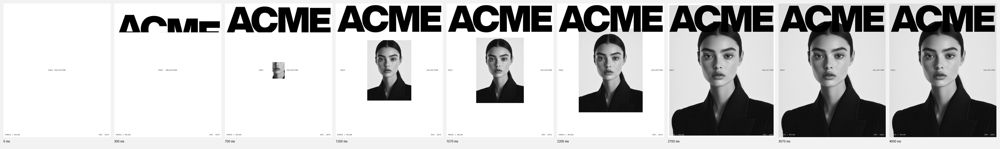

# The Edit: Collection Teaser 스타일 가이드

Jitter 프로젝트 **"The Edit: Collection Teaser"**를 분석해 정리한 텍스트, 컬러, 모션 가이드입니다. 모든 수치는 Jitter 프로젝트 원본 데이터(JSON)에서 그대로 가져왔고, 해석이 들어간 값에는 *근사* 또는 *추정*이라고 표시했습니다.



> 스토리보드는 원본 데이터로 장면을 다시 만들어 렌더링한 것입니다. 배경을 지운 포트레이트 원본은 받을 수 없어서, 실제 영상의 핵심 연출인 **모델 머리가 로고 앞으로 겹치는 장면**은 위 그림에 없습니다. 라벨 폰트도 대체 모노스페이스 폰트로 렌더링했습니다.

---

## 1. 무드 요약

- **흑백 에디토리얼.** 순수 흑(#000)과 백(#fff)만 쓰고, 색은 오직 흑백 사진의 회색 계조에서 나옵니다.
- **극단적인 타입 대비.** 화면 폭을 꽉 채운 초굵은 마스트헤드와 17px 모노스페이스 라벨을 맞붙입니다. 중간 크기의 텍스트는 없습니다.
- **잡지 표지 문법.** 로고는 맨 위, 모델은 로고 앞에 겹치고, 메타 정보(도시, 설립 연도, 시즌)는 네 모서리와 중앙선에 작게 놓습니다.
- **카메라 대신 창(window).** 포트레이트는 중앙의 작은 창으로 열린 뒤 화면 전체로 확장되고, 그 동안 사진 자체도 계속 줌인(0.7 → 1.85)됩니다.

## 2. 텍스트

### 영상에 쓰인 문구

| 레이어 | 문구 | 위치 |
|---|---|---|
| 로고 (아웃라인 SVG) | `ACME` | 상단, x16 y16, 1048×275 |
| 라벨 | `FW24` | 중앙선 y667, 이후 좌측 마진으로 이동 |
| 라벨 | `COLLECTION` | 중앙선 y667, 이후 우측 마진으로 이동 |
| 라벨 | `PARIS \| MILAN` | 좌하단, x16 y1320 |
| 라벨 | `EST. 1972` → `EST. 1992` | 우하단, 오른쪽 정렬 (아래 *원본 이슈* 참고) |

### 타입 스케일

| 토큰 | 폰트 | 굵기 | 크기 | 행간 | 자간 | 대소문자 |
|---|---|---|---|---|---|---|
| `masthead` | Helvetica Now Display (아웃라인) | 800 ExtraBold | 캔버스 폭에 맞춤 (글자 높이 ≈264px) | — | 타이트 | 대문자 |
| `label` | Quadrant Text Mono | 400 Regular | 17px | 80% | 7% (0.07em) | 대문자 |

- 마스트헤드는 **텍스트가 아니라 벡터 아웃라인**이라 폰트 없이도 똑같이 렌더링됩니다. 글자는 A·C·M·E 네 개의 개별 벡터로 나뉘어 있어 글자별 스태거 애니메이션을 줄 수 있습니다.
- 라벨은 전부 대문자이고, 넓은 자간과 좁은 행간을 씁니다. 구분자는 ` | `를 씁니다.
- 프로젝트 파일에 Saol Standard Thin Italic, Quadrant Text Regular, Helvetica Now Display ExtraBold 텍스트 레이어(“Five generations. One obsession with perfection. Explore the archive, reimagined for today.”)도 남아 있지만, **모두 삭제된 레이어이고 최종 영상에는 나오지 않습니다.**

## 3. 컬러

| 토큰 | HEX | 쓰임 |
|---|---|---|
| `paper` | `#ffffff` | 캔버스 배경. 풀블리드 이후 라벨 색 |
| `ink` | `#000000` | 로고, 기본 라벨 |
| `mask-placeholder` | `#d9d9d9` | 마스크 셰이프 채움값. 화면에 보이지 않음 |

- **사진 톤:** 완전한 모노크롬. 밝은 회색 스튜디오 배경(≈`#e6e6e6`–`#f2f2f2`, 이미지에서 추정)에 검정 테일러드 재킷을 입혀, 사진 자체가 흑/백 대비를 이어갑니다.
- **반전 규칙:** 사진이 화면을 덮으면 하단 라벨이 `ink` → `paper`로 바뀝니다. 같은 라벨을 흰색으로 한 벌 더 만들어 확장 마스크 안에 넣는 방식이라, 색이 페이드되지 않고 마스크 경계를 따라 **잘리듯** 바뀝니다.
- 그라데이션, 그림자, 액센트 컬러는 쓰지 않습니다.

## 4. 레이아웃

- 캔버스 **1080×1350 (4:5)**. 모든 요소는 **16px 마진**에 붙습니다. 로고 폭은 1080 − 2×16 = 1048px입니다.
- 포트레이트 창의 첫 크기는 **480×660**이고 캔버스 정중앙(540, 675)에 맞춥니다.
- `FW24`와 `COLLECTION`은 처음에 중앙선(y667)에서 서로 붙어 있다가, 창이 열리면서 좌우 마진(x16 / 오른쪽 끝 x1064)으로 밀려납니다.
- 레이어 순서(아래 → 위): 배경 포함 포트레이트 → 로고 → 라벨 → **배경 지운 포트레이트 + 흰 라벨 (확장 마스크)**. 그래서 확장 후에는 모델 머리가 로고 **앞에** 옵니다.

## 5. 모션

### 타임라인 (총 4000ms)

| 구간 | 대상 | 변화 | 이징 |
|---|---|---|---|
| **0–1201ms** | 로고 그룹 | translateY +200 → 0 | `rise` |
| **0–980ms** | 로고 글자 A·C·M·E | translateY +290 → 0, 각 800ms, **60ms 스태거** (0/60/120/180ms 시작) | `rise` |
| **120–1570ms** | 포트레이트 마스크 | 0×0 → 480×660, 중앙 기준 | `smooth` |
| **120–1570ms** | 포트레이트 이미지 | scale 0.7 → 1.09 | `smooth` |
| **120–1570ms** | `FW24` / `COLLECTION` | x −435 / +438 (좌우 마진까지 분리) | `smooth` |
| **1570–3070ms** | 포트레이트 마스크 | 480×660 → 1080×1350 (풀블리드) | `expand` |
| **1570–3070ms** | 포트레이트 이미지 | scale 1.09 → 1.85 | `expand` |
| **3070–4000ms** | — | 홀드 (930ms) | — |

### 모션 원칙

1. **클립 상승 리빌.** 로고 그룹은 `overflow: hidden`이라, 글자가 보이지 않는 기준선 아래에서 솟아오릅니다. 그룹(+200)과 글자(+290)가 서로 다른 거리를 동시에 움직여 2단 시차가 생깁니다.
2. **겹치는 시작.** 2단계(창 열림)는 1단계가 끝나기 전인 120ms에 시작합니다. 정적인 구간 없이 계속 흐르게 하는 장치입니다.
3. **이어 붙이는 연속 줌.** 창 열림이 끝나는 1570ms에 풀블리드 확장이 바로 시작되고, 이미지 스케일도 1.09에서 끊기지 않고 1.85까지 이어집니다.
4. **양쪽으로 밀어내기.** 창이 열리는 힘으로 라벨이 좌우로 밀려나는 것처럼 보이도록, 라벨 이동을 창 열림과 같은 시간·같은 이징에 맞춥니다.
5. **마지막엔 정지.** 마지막 930ms는 움직임 없이 정지 화면으로 둡니다.

### 이징 상세

| 토큰 | CSS | 원본 Jitter 설정 | 비고 |
|---|---|---|---|
| `rise` | `cubic-bezier(0, 0.47, 0.16, 1)` | custom path, P0 handle `{x:0, y:0.47036}`, P1 handle `0.84048` | 빠른 출발과 긴 감속. Jitter 핸들을 CSS 베지어로 옮길 때 해석이 들어감(*추정*) |
| `smooth` | `cubic-bezier(0.65, 0, 0.35, 1)` | `smooth:standard:v1`, intensity 50 | Jitter 프리셋의 **근사값** |
| `expand` | `cubic-bezier(0.75, 0, 0.2, 1)` | custom path, P0 handle `0.75`, P1 handle `0.8` | 강한 ease-in-out. 해석이 들어감(*추정*) |

## 6. 코드 토큰

```css
:root {
  /* color */
  --paper: #ffffff;
  --ink: #000000;

  /* type */
  --font-masthead: "Helvetica Now Display", "Helvetica Neue", Arial, sans-serif;
  --font-label: "Quadrant Text Mono", ui-monospace, "SFMono-Regular", monospace;
  --label-size: 17px;
  --label-leading: 0.8;
  --label-tracking: 0.07em;

  /* layout */
  --margin: 16px;

  /* motion */
  --ease-rise: cubic-bezier(0, 0.47, 0.16, 1);
  --ease-smooth: cubic-bezier(0.65, 0, 0.35, 1);
  --ease-expand: cubic-bezier(0.75, 0, 0.2, 1);
  --dur-letter: 800ms;
  --stagger-letter: 60ms;
  --dur-logo: 1201ms;
  --dur-window-open: 1450ms;
  --dur-full-bleed: 1500ms;
}

.label {
  font: 400 var(--label-size)/var(--label-leading) var(--font-label);
  letter-spacing: var(--label-tracking);
  text-transform: uppercase;
}
```

## 7. Do / Don't

**Do**
- 흑과 백 두 가지 색만 쓰고, 계조는 흑백 사진에 맡긴다.
- 마스트헤드는 마진 사이 폭을 꽉 채우고, 라벨은 17px 모노스페이스 대문자로 작게 둔다.
- 사진은 마스크 창으로 열고, 열리는 동안 이미지도 계속 스케일업한다.
- 다음 동작은 앞 동작이 끝나기 전(≈120ms)에 시작한다.
- 끝에는 1초 가까이 정지 화면을 둔다.

**Don't**
- 컬러 액센트, 그라데이션, 그림자를 넣지 않는다.
- 중간 크기 헤드라인이나 세 번째 서체를 넣지 않는다.
- 텍스트에 페이드인을 쓰지 않는다. 등장은 클립 상승, 색 전환은 마스크로 한다.
- 선형(linear) 이징을 쓰지 않는다.

## 8. 원본 이슈

- **설립 연도 불일치:** 검정 라벨은 `EST. 1972`인데, 마스크 안의 흰 라벨은 `EST. 1992`입니다. 그래서 풀블리드 확장 때 우하단 연도가 1972에서 1992로 바뀌어 보입니다. 레이어 이름도 각각 `EST. 1992`와 `EST. 1993`이라 서로 맞지 않습니다. 의도한 연출인지 확인이 필요합니다.
- `ACME`는 템플릿용 임시 브랜드명으로 보입니다.

## 9. 출처 데이터

- `scene.json`: 최종 영상에 쓰인 38개 노드만 추린 Jitter 원본 데이터입니다. 삭제된 레이어 261개는 뺐고, SVG 데이터 URI는 잘라냈습니다.
- `storyboard.png`: `scene.json`으로 장면을 다시 만들어 0 / 300 / 700 / 1200 / 1570 / 2200 / 2700 / 3070 / 4000ms 시점을 렌더링한 이미지입니다.
